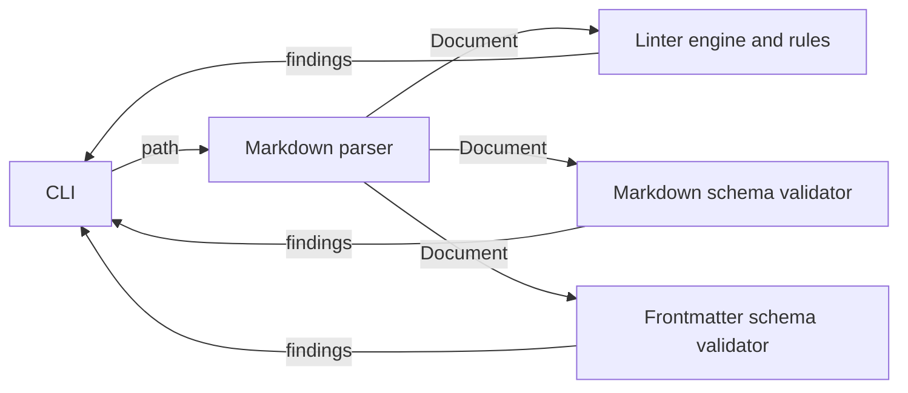

# Pipeline

## Overview

How one run of tiredize flows from the command line to its findings,
and the types and principles every component shares. Each component's
own contract is on its page under `components/`.

## Data Flow



1. The [CLI](../components/cli.md) takes the paths and up to three
   configuration files, one per check.
2. For each path, the [markdown parser](../components/markdown-parser.md)
   builds a `Document`: frontmatter, sections and the elements in each.
3. The [linter engine](../components/linter-engine.md) runs the enabled
   [rules](../components/linter-engine.md); the [markdown schema
   validator](../components/markdown-schema-validator.md) checks the
   section tree; the [frontmatter schema
   validator](../components/frontmatter-schema-validator.md) checks the
   frontmatter. Each runs only when its flag was given a non-empty
   value (see [CLI](../components/cli.md)).
4. The CLI prints each path's findings and returns the exit status.

The checks never call each other. They share only the parsed
`Document` and the result types below.

## Shared Types

```python
# tiredize/core_types.py
@dataclass(frozen=True)
class Position:
    offset: int   # character index from the start of the document
    length: int   # characters the finding covers, starting at offset

@dataclass(frozen=False)
class RuleResult:
    position: Position
    rule_id: str | None
    message: str

class RuleNotFoundError(Exception): ...
```

Every check reports a finding as a `RuleResult`. Offsets count
characters from the start of the file, frontmatter included, so the CLI
can turn any finding into a line and column with
`Document.line_col()`. The CLI prints only the start of a finding;
`length` is for Python callers.

Linter findings carry the rule id (`line_length`); validator findings
carry a dotted id (`schema.markdown.missing_section`,
`schema.frontmatter.wrong_type`). `rule_id` is `None` only on a result
a rule function returns: rules leave it unset and the [linter
engine](../components/linter-engine.md) stamps the rule id on every
result before returning it, so every finding the CLI prints has one.

## Findings and Errors

Across every component, a problem in the **document** is a finding and
a problem in the **configuration** is an error. A bad rules file, an
invalid schema, an unknown rule or an ambiguous schema raises, and the
CLI stops the run (see [CLI](../components/cli.md)). Two configuration
mistakes do not raise: an empty rules file enables no rule, and a flag
given an empty value skips its check; both are open questions on the
[CLI](../components/cli.md) page.

## Design Decisions

- **Configuration mistakes fail loudly.** A typo that switched a check
  off while the run exited clean would be worse than no check, because
  it looks like a pass. This is why rule configuration, both schema
  loaders and the CLI all treat a configuration fault as an error.
- **Errors abort, findings continue.** One rule for the whole run, so
  the exit status can be stated in one sentence; the trade-off is on
  the [CLI](../components/cli.md) page.
- **One parse, many checks.** Every check reads the same `Document`, so
  a parser fix reaches every check at once and no check re-parses
  markdown.
