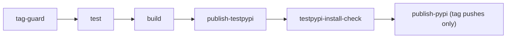

# Releasing

## Overview

How tiredize is versioned, built and published, and how to cut a
release. Releases go to PyPI, after a pass through TestPyPI, by
`.github/workflows/release.yaml`. How `--version` reports the version
is on the [CLI](../components/cli.md) page; how users install a release
is on [installing and running](./installing-and-running.md); the
workflow that tests pull requests is on [CI](../practices/ci.md).

## Versioning

The version comes only from git tags. No file in the repository holds
a version number: `pyproject.toml` declares `dynamic = ["version"]`,
and hatchling's `hatch-vcs` plugin (in `[build-system] requires`)
derives the version from the tags when tiredize is built or installed.

```toml
[tool.hatch.version]
source = "vcs"
raw-options = { local_scheme = "no-local-version" }
```

| Commit being built                    | Version            | Example       |
|---------------------------------------|--------------------|---------------|
| Tagged `vX.Y.Z`                       | `X.Y.Z`            | `0.1.0`       |
| `N` commits after the last `vX.Y.Z`   | `X.Y.(Z+1).devN`   | `0.1.1.dev3`  |
| No release tag in its history         | `0.1.devN`, `N` counting every commit | `0.1.dev60` |

- **Release tags** have the form `vX.Y.Z`: three dot-separated
  numbers with no leading zeros, nothing before or after. The number
  follows [semantic versioning](https://semver.org/) and is chosen by
  hand when tagging; nothing bumps it automatically.
- **Dev versions** are what every untagged commit builds. A dev version
  sorts after the last release and before the next patch release
  (`0.1.0 < 0.1.1.dev3 < 0.1.1`). pip treats it as a pre-release, so
  `pip install tiredize` never picks one unless it is pinned exactly or
  `--pre` is given. It names a distance from the last tag, not a
  commit: two different commits the same distance from the tag build
  the same version.
- **No local segment.** `no-local-version` drops the `+g<hash>` suffix
  that hatch-vcs would otherwise add to dev versions, because PyPI and
  TestPyPI reject versions that carry one.
- **History is required.** hatch-vcs reads the tags from the clone, so
  a shallow clone that lacks the tag builds a wrong dev version. Every
  job in `release.yaml` that builds or installs tiredize checks out
  with `fetch-depth: 0`. There is no `fallback-version`: building from
  a source tree with neither git metadata nor an sdist's `PKG-INFO`,
  such as a GitHub "Download ZIP" archive, fails rather than invent a
  number. An unpacked sdist builds with the version in its `PKG-INFO`.
- **The installed version is fixed at install time.** An editable
  install (`pip install -e .`) records the version current when it ran;
  `tiredize --version` keeps reporting it after later commits or tags
  until the install is repeated.

## Release Workflow

`release.yaml` (workflow name `Release`) runs on two triggers:

| Trigger                          | Publishes                                  |
|----------------------------------|--------------------------------------------|
| Push of a tag matching `v*`      | The tag's version to TestPyPI, then PyPI   |
| Manual run (`workflow_dispatch`) | A dev version to TestPyPI only             |

Its jobs run in this order; each needs the one before it, so a failure
anywhere stops everything after it:



| Job                      | What it does                                                                                           |
|--------------------------|--------------------------------------------------------------------------------------------------------|
| `tag-guard`              | On a tag push, fails unless the tag is exactly `vX.Y.Z` and the tagged commit is on `main`. Skips its checks on a manual run |
| `test`                   | On Python 3.12, installs tiredize with `pip install -e .`, runs `flake8 tiredize tests` and the full `pytest` suite |
| `build`                  | Builds the sdist and wheel once with `python -m build`, requires exactly one of each, runs `twine check --strict`, installs the wheel into a clean venv and checks the version (below), and uploads `dist/` as the `dist` artifact |
| `publish-testpypi`       | Uploads the `dist` artifact to TestPyPI with `skip-existing: true`, in the `testpypi` environment     |
| `testpypi-install-check` | Installs that exact version from TestPyPI into a clean venv, its dependencies from pypi.org only, runs `pip check`, and requires `tiredize --version` to print `tiredize <version>` |
| `publish-pypi`           | On tag pushes only, uploads the same `dist` artifact to PyPI, in the `pypi` environment, which waits for approval |

The guards, and what each one stops:

- **Malformed tag.** A tag that matches `v*` but is not `vX.Y.Z`
  (`v1.2`, `v1.2.3rc1`, `v01.2.3`) fails `tag-guard`, so nothing is
  tested, built or published.
- **Tag off `main`.** The tagged commit must be `main`'s tip or an
  ancestor of it, as fetched from `origin` during the run.
- **Version mismatch.** On a tag push, the wheel's installed version
  must equal the tag without its `v`. On a manual run it must be a dev
  version, so a practice run can never put a release number on
  TestPyPI ahead of its tag.
- **Broken package.** The wheel is installed and run from outside the
  checkout, so the source tree cannot stand in for it, and
  `tiredize --version` must print `tiredize <installed version>`.
- **Broken publication.** The TestPyPI install check installs the
  published files as a user would. TestPyPI's index can lag behind an
  upload, so the install is tried up to ten times, 30 seconds apart,
  before the job fails.

The files published to PyPI are the files `build` produced in the same
run; nothing is rebuilt between the TestPyPI and PyPI uploads.

### Trusted Publishing

Both publish jobs use `pypa/gh-action-pypi-publish`, pinned to a
commit like every action (see [CI](../practices/ci.md)), with Trusted
Publishing: GitHub issues the job a short-lived OIDC token, and the
registry accepts it because it has a trusted publisher registered for
that workflow. No API token, password or secret is stored anywhere.

The publish action runs its own bundled twine, not the one the `build`
job installs, so `twine check` passing in `build` does not prove the
action will accept the files. When hatchling starts writing a newer
core metadata version, the action may need updating too: v1.13.0
rejected metadata 2.5 from hatchling 1.33.0, which v1.14.2 fixed.

The workflow is read-only by default (`contents: read`); only the two
publish jobs get `id-token: write`, and nothing else. Each registry's
trusted publisher names the owner `tired-labs`, the repository
`tiredize`, the workflow file `release.yaml` and an environment:
`testpypi` on TestPyPI, `pypi` on PyPI. Renaming the workflow file or
an environment breaks publishing until the registered publisher is
changed to match.

### Environments

| Environment | Used by            | Protection                                   |
|-------------|--------------------|----------------------------------------------|
| `testpypi`  | `publish-testpypi` | None; runs as soon as `build` passes         |
| `pypi`      | `publish-pypi`     | Waits for a maintainer to approve the run    |

## Cutting a Release

1. **Merge to `main`.** Everything in the release goes through a pull
   request (see [contributing](../practices/contributing.md)); CI must
   pass.
2. **Choose the number.** Pick `X.Y.Z` by semantic versioning against
   the last release (`git tag --list 'v*'` lists them). A version that
   has reached TestPyPI or PyPI is never reused. A failed release whose
   files reached TestPyPI leaves its tag behind: leave that tag in place
   and choose the next number (see
   [recovering from a failed run](#recovering-from-a-failed-run)).
3. **Tag the commit on `main`.** Tag `main`'s current tip, or an
   earlier commit on `main`:

   ```bash
   git switch main
   git pull --ff-only
   git tag -a vX.Y.Z -m "vX.Y.Z"
   ```

4. **Push the tag.** This starts the `Release` workflow:

   ```bash
   git push origin vX.Y.Z
   ```

5. **Watch the run** in the repository's Actions tab. When the
   TestPyPI install check passes, the run waits at `publish-pypi`.
6. **Approve the `pypi` deployment.** On the run's page, choose
   "Review deployments", select `pypi` and approve. The job uploads to
   PyPI.
7. **Check the release.** In a clean environment,
   `pip install tiredize==X.Y.Z` then `tiredize --version` prints
   `tiredize X.Y.Z`.

### Practice Runs

A manual run of `Release` (Actions tab, "Run workflow", any branch)
builds the chosen branch's dev version, publishes it to TestPyPI and
runs the install check, but never reaches PyPI. Use it to try the
release path without cutting a release. Run it from an untagged commit:
a commit that carries a release tag builds a release number and fails
the dev-version check. Because dev versions are not unique per commit,
a practice run whose version is already on TestPyPI skips the upload
and checks the files already there.

### Recovering from a Failed Run

What to do depends on how far the run got. Check whether the version is
on TestPyPI before changing any tag.

- **Failed before `publish-testpypi`** (tag guard, tests or build).
  Nothing was published. Delete the tag locally and on `origin`
  (`git tag -d vX.Y.Z`, `git push origin :refs/tags/vX.Y.Z`), fix the
  cause through a pull request to `main`, then tag and push again. A
  failure that was not the code's fault (a runner or network problem)
  can instead be re-run from the run's page.
- **Failed at or after `publish-testpypi`** (the install check, the
  PyPI upload, or an approval that was rejected). On the run's page,
  within 30 days of the run starting, choose "Re-run failed jobs".
  GitHub re-runs the failed jobs and the jobs that depend on them
  within the same run, reusing
  the outputs and artifacts of the jobs that succeeded, so `build` does
  not run again and the same `dist` artifact reaches PyPI. Do not
  choose "Re-run all jobs": it runs `build` again, and PyPI would get a
  second build while TestPyPI keeps the first, breaking the build-once
  rule. (This follows GitHub's documented re-run behaviour; it has not
  yet been exercised on this workflow.) `skip-existing` lets the
  TestPyPI upload pass for files already there, so the re-run can reach
  PyPI. Do not move the tag to a different commit: TestPyPI never
  accepts the same file name twice, so the re-run would check the old
  files on TestPyPI while publishing new ones to PyPI. If the code must
  change, leave the tag in place and release the next version instead.
- **Approval expired** (no one approved `pypi` in time). A job waiting
  for deployment approval fails after 30 days, and a run can be re-run
  only within 30 days of starting, so no re-run is left. Leave the tag
  in place and release the next version. Do not delete and push the tag
  again: that starts a new run that builds again, so PyPI would get
  files TestPyPI never checked. (This follows GitHub's documentation; it
  has not yet been exercised on this workflow.)
- **Partly published to PyPI** (PyPI accepted one of the two files and
  not the other). A re-run fails: `publish-pypi` has no
  `skip-existing`, so its upload stops at the file already there. The
  version cannot be completed; leave the tag in place and release the
  next version.
- **Published to PyPI.** The release is final. PyPI never accepts a
  file name twice, even after a deletion, so a published version's
  files cannot be replaced; a fix is a new version.

## Design Decisions

- **Versions come only from git tags, through hatch-vcs.** One source
  means a published version and the commit it came from can never
  disagree, and no file has to be edited to release.
- **Semantic versioning, chosen by hand.** There is no automated
  bumping or release tooling; the person tagging decides what the
  change means.
- **No local version segment,** because PyPI and TestPyPI reject it,
  which would make every dev version unpublishable.
- **No fallback version.** A build that cannot see the tags fails
  instead of publishing a made-up number.
- **Trusted Publishing only.** No long-lived token or password is
  stored, so there is no secret to leak or rotate.
- **TestPyPI, an install check, then approval before PyPI.** A release
  is installed from a registry and run before it reaches PyPI, where a
  version can never be replaced, and a person approves the last step.
- **Manual runs are TestPyPI practice runs that build dev versions,**
  so the release path can be exercised at any time without reserving
  a release number.
- **Build once per run, publish the same files twice,** so what was
  checked on TestPyPI is what reaches PyPI, not a second build of it.
- **Only tiredize comes from TestPyPI in the install check.** Anyone
  can upload any name to TestPyPI, so letting pip resolve dependencies
  across both indexes could install a look-alike; dependencies come
  from pypi.org alone.
- **`skip-existing` on TestPyPI only,** so a re-run of a tag whose
  TestPyPI upload succeeded can still reach PyPI, while a PyPI upload
  of an existing version still fails loudly.
- **The workflow file is named exactly `release.yaml`,** as registered
  with both registries' trusted publishers.
- **The package author is `TIRED Labs`, with no email.** Users reach the
  project through GitHub issues.
- **This page is the release procedure.** There is no separate
  procedure file to drift from it.
